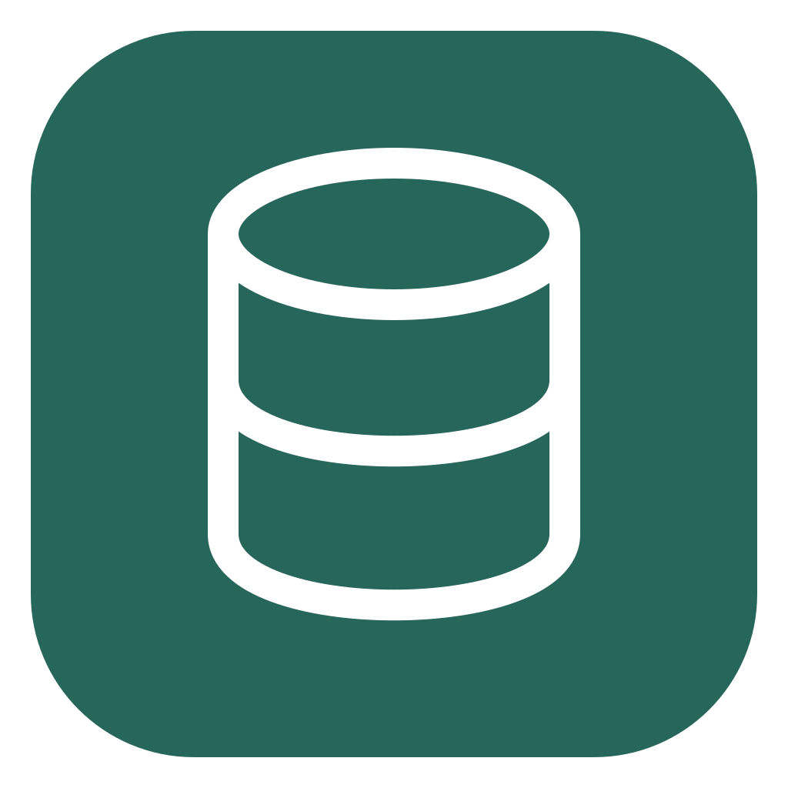
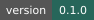
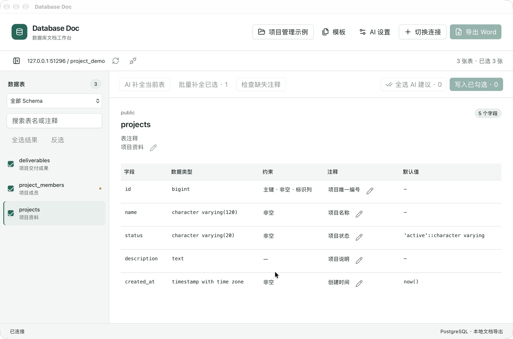
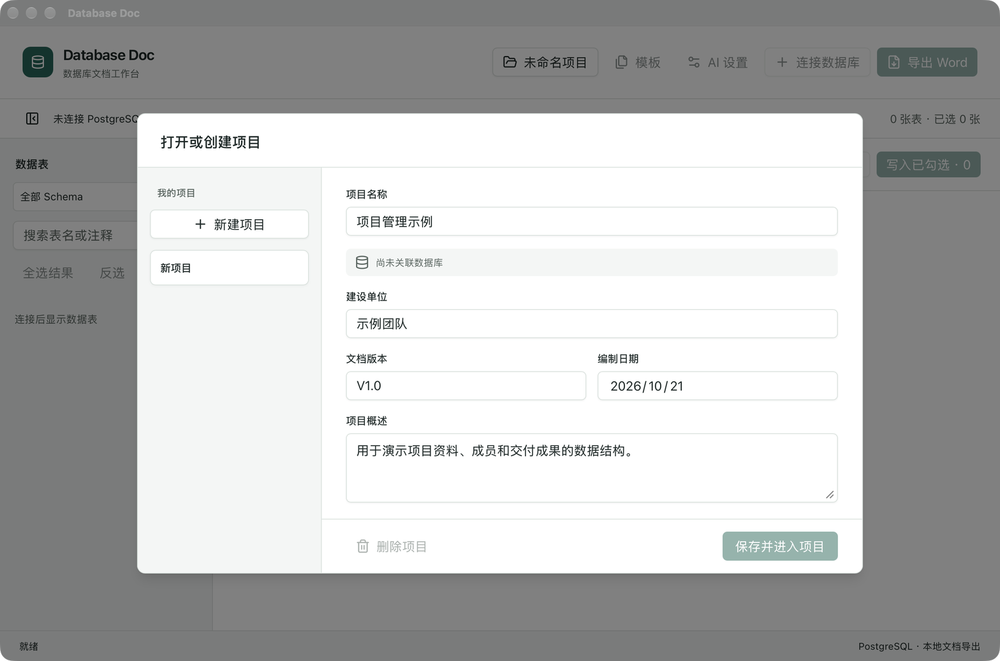
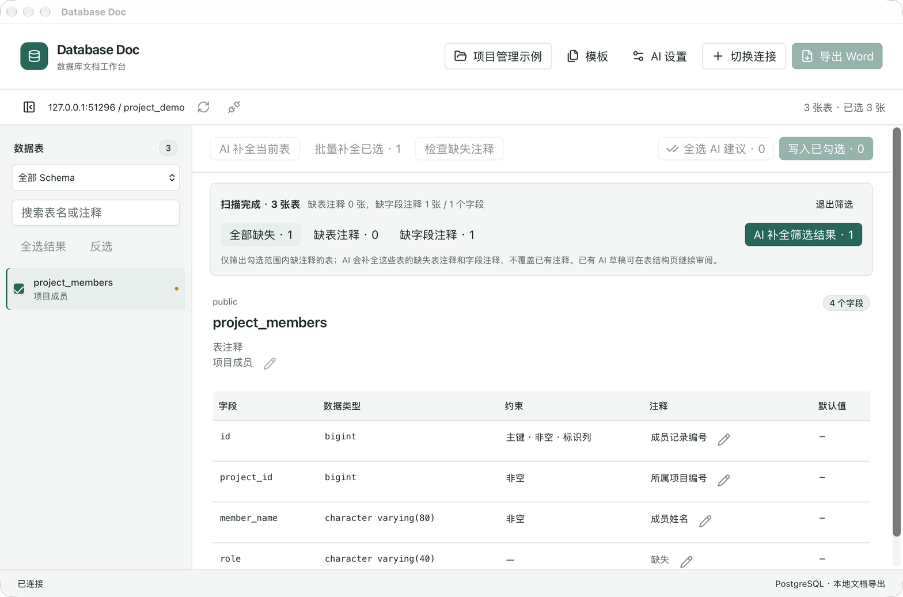
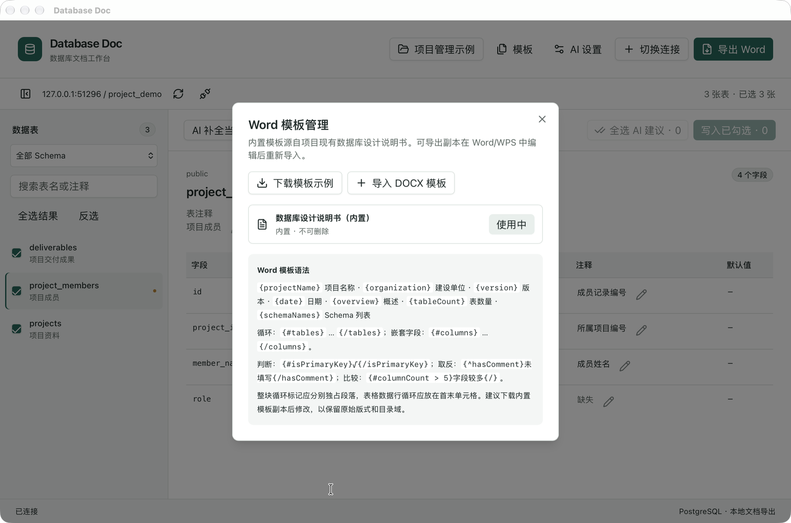
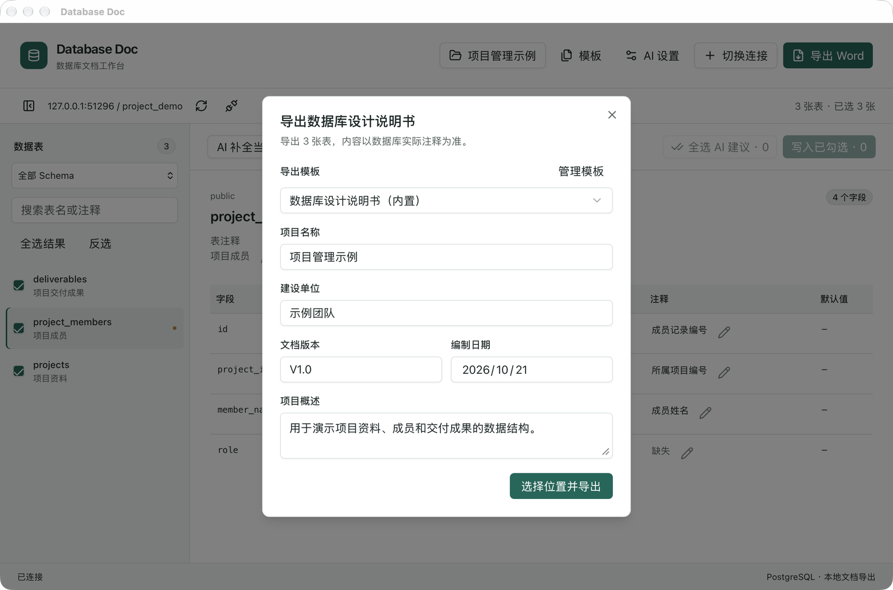

<p align="center">
  
</p>

<h1 align="center">Database Doc</h1>

<p align="center">连接 PostgreSQL，整理数据注释，生成 Word 设计说明书。</p>

<p align="center">
  
  
  
  <a href="LICENSE"></a>
</p>

<p align="center">
  <a href="#主要功能">主要功能</a> ·
  <a href="#界面预览">界面预览</a> ·
  <a href="#安装">安装</a> ·
  <a href="docs/README.md">文档</a>
</p>



## 主要功能

- **结构查看**：搜索和筛选数据表，查看字段、类型、约束与注释。
- **注释整理**：检查缺失项，手动编辑，或通过 AI 批量补全、审阅后写入。
- **Word 导出**：勾选数据表生成 `.docx`，支持内置和自定义模板。
- **项目管理**：分别保存项目信息、数据库连接、选表和模板。

AI 支持 OpenAI 兼容服务；未确认写入的建议不会修改数据库，也不会进入导出文档。

## 界面预览

<table>
  <tr>
    <td align="center"><strong>项目管理</strong><br /></td>
    <td align="center"><strong>缺失注释检查</strong><br /></td>
  </tr>
  <tr>
    <td align="center"><strong>模板管理</strong><br /></td>
    <td align="center"><strong>Word 导出</strong><br /></td>
  </tr>
</table>

## 安装

### 使用应用

将 `Database Doc.app` 拖入“应用程序”后打开。目前提供 macOS 版本，尚未完成 Apple 公证。

**创建项目 → 连接 PostgreSQL → 勾选数据表 → 导出 Word。**

### 从源码构建

需要 Node.js 24、Rust 和 macOS Command Line Tools。在项目目录执行：

```bash
npm ci
npm run tauri -- build --bundles app
```

应用输出到 `src-tauri/target/release/bundle/macos/Database Doc.app`。

## 文档

[模板语法](docs/template-syntax.md) · [开发与构建](docs/development.md) · [凭据存储](docs/local-encrypted-credentials.md) · [全部文档](docs/README.md)

## 开源协议

本项目采用 [MIT License](LICENSE)。
